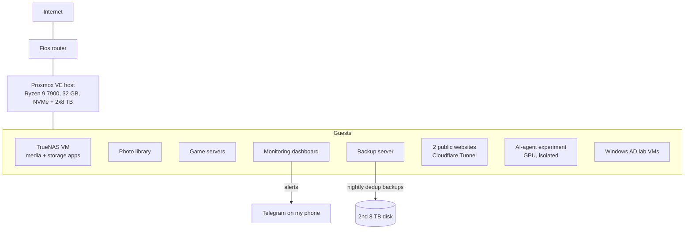

# Building-a-Homelab

My homelab: what I built, why, what it runs, and how I keep it running. It tracks the current state of the lab and every notable change.

## The lab in one paragraph
One Proxmox VE 9 server (Ryzen 9 7900, 32 GB RAM, NVMe + two 8 TB disks) hosts ~10 always-on guests: a media and storage stack on TrueNAS, a self-hosted photo library, game servers, two public websites, a Proxmox Backup Server, a custom monitoring dashboard, and an isolated AI-agent experiment with a GPU. Everything is backed up nightly with deduplication, verified automatically, and restore-tested weekly. Remote access is Tailscale only; public sites leave through Cloudflare tunnels, with no inbound port forwards.

## Architecture at a glance

## The numbers
| | |
|---|---|
| Always-on guests | about 10 (VMs and containers) |
| Backups | nightly, deduplicated, verified daily, **restore-tested weekly** |
| Open inbound ports | **0** (Tailscale for me, Cloudflare Tunnel for the public sites) |
| Monitoring | custom dashboard, about 80 API endpoints, alerts to Telegram |
| Isolation | public-facing and experimental guests cannot reach the home network |

## Projects that run on it
- **Monitoring and admin dashboard:** health checks, alerts, one-click patching, browser terminals with AI agents
- **Backup and DR automation:** restore testing, verification, deduplicated backups
- **Patch management:** automatic security updates plus sequential update-all
- **Proxmox provisioning:** a new container in one command
- **Zero-trust remote access:** Tailscale, tunnels, per-guest firewalls
- **Two production websites** and a **self-hosted AI trading research lab**

## Start here
1. [Hardware](docs/hardware.md): what runs the lab
2. [Network](docs/network.md): layout, remote access, isolation
3. [Services](docs/services.md): what is hosted and where
4. [Backups](docs/backups.md): strategy, schedule, restore testing
5. [Monitoring](docs/monitoring.md): dashboard, alerts, health checks
6. [Runbooks](docs/runbooks.md): how I fix and rebuild things
7. [Changelog](docs/changelog.md): dated history

## Goals
- Learn real-world systems, networking and self-hosting by running them for real
- Record design decisions so the lab can be rebuilt from this repo
- Treat it like production: backups that are tested, updates that are tracked, alerts that reach my phone

## Status
Actively running and improving. See the [changelog](docs/changelog.md).

## Roadmap
- [x] Proxmox host, TrueNAS, media, photos, game servers
- [x] Nightly deduplicated backups (Proxmox Backup Server) + weekly restore tests
- [x] Custom monitoring dashboard with Telegram alerts
- [x] Network isolation for internet-facing and experimental guests
- [ ] UPS for the host
- [ ] Network diagram
- [ ] Off-site backup copy
